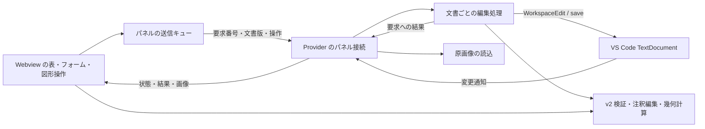

# Screen Spec Annotator 設計レビューとリファクタリング計画

## 1. 調査対象と前提条件

**推奨は、編集と保存の回帰確認を先に確立し、その確認を使って Webview の送信キューとホストの文書編集をそれぞれ切り出すこと。** 現行の `TextDocument`、v2 の注釈形式、Canvas と SVG の組み合わせは、後続要件にも使える。最も手戻りが大きくなるのは、入力中の値、送信待ちの操作、文書に反映済みの値の扱いを曖昧にしたまま、共有列と出力を追加する場合である。

- 調査日は 2026-11-21。対象はローカルの `main`、HEAD `b836a3b`。開始時の `git status --short --branch` は `## main...origin/main` で、作業ツリーとステージに変更はなかった。設計判断の基準 `64a1c51` から HEAD までの差分は `design-decisions.md` の追加のみ。
- 要件定義 v0.20、実装設計 v0.17、設計判断、README、第三者ライセンス表記、全ソース（TypeScript 6 ファイルと CSS）、マニフェスト、ロックファイル、TypeScript 設定、F5 起動設定を調査した。リポジトリに `AGENTS.md`、テストコード、テスト実行スクリプト、CI 定義は見当たらない。E2E-001〜021 は受け入れシナリオの設計である。[要件定義](requirements.md)・[実装設計](design.md)・[設計判断](design-decisions.md)・[開発手順](../README.md)
- Windows、Node.js 24.18.0、既設の TypeScript 5.9.3 と esbuild 0.25.12 を使用。VS Code の宣言下限と型定義は 1.95 系、バンドルのターゲットはホストが Node 20、Webview が Chrome 128。開発環境での成功と配布対象環境での動作確認は別に記録する。[package.json](../package.json#L11)・[package-lock.json](../package-lock.json#L473)・[tsconfig.json](../tsconfig.json)・[起動設定](../.vscode/launch.json)

| 今回の検証 | 結果と証拠の範囲 |
| --- | --- |
| 型・バンドル | `npm run check` 成功。両エントリーをビルドスクリプトと同じ platform・target・external で、esbuild の `write: false` を用いてメモリ上でバンドルできた。 |
| 実モデルの動作 | 既設の TypeScript で `annotation.ts` をメモリ上で読み込み、設計書の v2 JSON 例の受理、BOM 付き再読込、日本語・改行入りの既存列値の保持、最大番号削除後の採番、複数座標の一括拒否、軸別の丸番号追従、貼り付け時の別 ID・番号・値の複製を確認した。 |
| 静的な画面契約 | 12 コマンドの宣言を登録対象と照合。9 配置のモデル・設定列挙・ツールバーの選択肢が一致。Webview の固定 ID 参照に対応する HTML 要素があり、固定 ID の重複もなかった。 |
| 実機で残る確認 | Extension Development Host での操作、IME、保存ダイアログ、Undo/Redo、複数パネルの競合、JPEG の向き、VSIX のインストール、描画性能は未検証。§3 の「実装済み」は操作経路をコードで追えたことを示す。実機での合格は §10 で判定する。 |

## 2. 現在のアーキテクチャ概要

| 境界・所有者 | 現在の責務と依存 |
| --- | --- |
| マニフェストと `activate` | `*.annotations.json` の Custom Text Editor、作成コマンド、コピー・貼り付け、9 配置を登録。右クリックはメニュー条件とパネル固有のトークンで対象を特定する。登録した Disposable は `context.subscriptions` が所有する。[package.json](../package.json#L46)・[extension.ts](../src/extension.ts#L386) |
| ホストの `AnnotationEditor` | パネルごとに HTML、メッセージ受信、文書変更購読、画像読込を束ねる。プロバイダー内で文書ごとの Promise 列と、同じウィンドウの注釈タブで共有するコピー内容・コピー操作の順序を管理する。[extension.ts](../src/extension.ts#L89) |
| 文書とモデル | 永続化される編集状態の正本は VS Code の `TextDocument`。ホストは現在の JSON をパースし、得られたモデルを編集し、整形した全文を一つの `WorkspaceEdit` で置換する。`annotation.ts` は v2 の型・検証、採番、スタイル、配置計算、貼り付けを担い、VS Code・DOM への依存がない。[extension.ts](../src/extension.ts#L178)・[annotation.ts](../src/annotation.ts#L198) |
| 原画像 | 注釈ファイルからの相対パスを解決し、同じバイト列から形式、EXIF 向き補正後の寸法、SHA-256 を取得する。初回または参照パスの変更時にパネルへ送る。デコードと寸法照合、Canvas 描画は Webview が担う。[original-image.ts](../src/original-image.ts#L12)・[extension.ts](../src/extension.ts#L129)・[editor.ts](../src/webview/editor.ts#L208) |
| Webview と通信 | `protocol.ts` の型を両側で共有。Webview は最後に受けた文書版と、選択、表示変換、ジェスチャー、フォームの下書き、送信待ち・応答待ちを所有する。行は ID ごとに DOM を再利用し、SVG は図形を再構成する。アイコンは固定 SVG を両バンドルから利用する。[protocol.ts](../src/protocol.ts)・[editor.ts](../src/webview/editor.ts#L77)・[material-icons.ts](../src/material-icons.ts#L26)・[editor.css](../media/editor.css#L87) |

通常の編集は「入力 → ローカルキュー → 要求番号と文書版を付けて送信 → ホストで検証・直列実行 → 文書変更通知 `state` と要求への応答 `result` → 表示更新」の順で進む。名称は IME 確定後も含め入力時に送る。座標は「座標を適用」または保存キーなどの確定操作まで DOM に残る。保存キーでは数値スタイル、座標を確定してから `save` をキューに置く。文書の dirty・保存・破棄・Undo の主体は VS Code である。[editor.ts](../src/webview/editor.ts#L108)・[editor.ts](../src/webview/editor.ts#L327)・[editor.ts](../src/webview/editor.ts#L1009)・[extension.ts](../src/extension.ts#L182)

## 3. 機能の実装状況

41 件中、**実装済み 26 件、部分実装 7 件、未実装 8 件**。要件の操作・受け入れ条件を単位とした。既存 JSON を保存できても、その内容を操作する GUI がなければ「部分」とした。「未」は対応する利用者操作がまだ提供されていないことを表す。表の FR 番号は [要件定義 §3](requirements.md#L36) に対応する。

| FR | 判定 | 利用できる操作、残る条件、コード上の根拠 |
| --- | --- | --- |
| 001・002 | 実装済み | PNG/JPEG の選択、保存先指定、同名時の既存ファイル選択、専用エディターでの画像・項目の再表示。各パネルは渡された文書に結び付く。[extension.ts](../src/extension.ts#L40)・[extension.ts](../src/extension.ts#L114)・[original-image.ts](../src/original-image.ts#L24) |
| 003・004・005 | 実装済み | 画像と SVG の共通変換と逆変換、選択・追加・パンモード、矩形の作成・移動・リサイズ・削除、円と数字テキストによる 21 番以降の表示、丸番号単独移動がある。[editor.ts](../src/webview/editor.ts#L698)・[editor.ts](../src/webview/editor.ts#L741)・[editor.ts](../src/webview/editor.ts#L876)・[annotation.ts](../src/annotation.ts#L546) |
| 006 | 実装済み | 矩形・円と行のチェック・中間状態を項目 ID で同期する。[editor.ts](../src/webview/editor.ts#L292)・[editor.ts](../src/webview/editor.ts#L368) |
| 007 | 部分 | 名称 textarea には入力・IME 確定処理がある。`values` は既存の文字列を保持するが、任意列セルの表示・編集操作はない。[editor.ts](../src/webview/editor.ts#L327)・[annotation.ts](../src/annotation.ts#L187) |
| 008 | 実装済み | 最大番号を独立して保存し、削除時に減らさない。1〜3 発行後に 3 を削除して再読込し、4 が割り当たることをモデルで確認した。[annotation.ts](../src/annotation.ts#L566)・[annotation.ts](../src/annotation.ts#L590) |
| 009 | 部分 | 名称・位置編集や削除で残存項目の番号を維持。並べ替え・画像更新まで含む受け入れ条件は後続機能に依存する。[annotation.ts](../src/annotation.ts#L573)・[annotation.ts](../src/annotation.ts#L602) |
| 010 | 未 | 再付番案の表示・取消・確定の操作がない。最大番号と各番号を分けたモデルは利用できる。[annotation.ts](../src/annotation.ts#L71)・[annotation.ts](../src/annotation.ts#L87) |
| 011 | 部分 | 表は `items` の配列順で、番号順に再ソートしない。利用者による行の並べ替えと順序を反映する出力は未提供。[editor.ts](../src/webview/editor.ts#L301)・[editor.ts](../src/webview/editor.ts#L344) |
| 012 | 部分 | 固定の番号・名称を表示。列定義が存在する場合も同じ固定ヘッダーを使い、フォルダー直下の `columns.json` を参照する経路がない。[extension.ts](../src/extension.ts#L372)・[editor.ts](../src/webview/editor.ts#L311) |
| 013・014 | 未 | 列設定タブ、追加・改名・順序変更・非表示・再表示、同一フォルダーへの反映は未提供。マニフェストが登録するのは注釈エディターのみ。[package.json](../package.json#L143)・[design.md](design.md#L144) |
| 015 | 部分 | v2 の番号・名称・配列順・座標・スタイル・既存の列値を読み書きできる。任意列入力・並べ替えを GUI で行ってから保存・再表示する一連の条件が残る。保存経路別の確認は §10。[annotation.ts](../src/annotation.ts#L198)・[extension.ts](../src/extension.ts#L222)・[editor.ts](../src/webview/editor.ts#L1009) |
| 016 | 実装済み | 注釈の親ディレクトリ基準で相対参照し、区切りを保存時に正規化する。複数仕様で画像を共有でき、別ドライブ等で相対参照を作れない場合にはエラーを返す。[original-image.ts](../src/original-image.ts#L12)・[extension.ts](../src/extension.ts#L70) |
| 017 | 部分 | 読込時のハッシュ差の通知、寸法不一致時の通常の座標操作の停止がある。同じパスの差し替えを開いた全タブに届ける監視と、差し替え中の入力保持は未達。[extension.ts](../src/extension.ts#L129)・[editor.ts](../src/webview/editor.ts#L244) |
| 018・019 | 未 | 確認済み画像・座標基準・確認待ちフラグの保存欄はある。仕様単位の確認確定、寸法変更時の拡縮／手動調整の選択はない。寸法差の警告は FR-017 の部分実装に計上した。[annotation.ts](../src/annotation.ts#L71)・[annotation.ts](../src/annotation.ts#L237)・[editor.ts](../src/webview/editor.ts#L250) |
| 020 | 部分 | JSON エディターで `imagePath` を変えれば再解決・再読込され、項目は文書に残る。専用画面の「参照画像を変更」と変更後の確認手順がない。[extension.ts](../src/extension.ts#L133)・[extension.ts](../src/extension.ts#L156)・[design.md](design.md#L166) |
| 021・022・023 | 未 | 原寸注釈 PNG、Markdown/CSV、保存版を揃えた一括出力と再出力は未提供。現在の Canvas は原画像表示用で、出力要求も出力ファイルの書込み経路もない。[editor.ts](../src/webview/editor.ts#L224)・[protocol.ts](../src/protocol.ts#L15)・[design.md](design.md#L168) |
| 024 | 実装済み | ファイル内で一意の 6 文字 ID。衝突時の再生成、重複 ID／番号の読込拒否、表示番号との分離がある。[annotation.ts](../src/annotation.ts#L212)・[annotation.ts](../src/annotation.ts#L506)・[extension.ts](../src/extension.ts#L209) |
| 025・031 | 実装済み | どちらの図形を選んでも項目単位で数値編集する。混在表示、指定軸だけの一括更新、全件検証後の反映がある。1 件が範囲外なら先行項目も不変であることをモデルで確認した。[editor.ts](../src/webview/editor.ts#L427)・[editor.ts](../src/webview/editor.ts#L508)・[annotation.ts](../src/annotation.ts#L435) |
| 026・028・029・035 | 実装済み | 6 方向の揃え、両端固定の等間隔整列、不成立時の一括中止、矩形優先／円単独の基準、移動時の丸番号追従、リサイズ時の独立を追跡できる。[annotation.ts](../src/annotation.ts#L376)・[annotation.ts](../src/annotation.ts#L444)・[editor.ts](../src/webview/editor.ts#L394)・[editor.ts](../src/webview/editor.ts#L897) |
| 027・032 | 実装済み | 属性別の共通値・項目上書き・解除、直径による円の境界と中心補正、輪郭の画面 px 指定。実倍率での見え方は実機確認が残る。[annotation.ts](../src/annotation.ts#L480)・[editor.ts](../src/webview/editor.ts#L595)・[editor.ts](../src/webview/editor.ts#L692)・[editor.css](../media/editor.css#L90) |
| 030・036・037 | 実装済み | 選択モードで開始し、クリック・完全包含の範囲選択・Shift 追加・三状態表示に対応。Esc は解除、Delete は項目削除で入力欄を除外。選択枠は共通色を使う。[editor.ts](../src/webview/editor.ts#L85)・[editor.ts](../src/webview/editor.ts#L735)・[editor.ts](../src/webview/editor.ts#L859)・[editor.ts](../src/webview/editor.ts#L977) |
| 033・039 | 実装済み | ツールバーと右クリックの対象を区別した 9 配置。追加のたびにユーザー設定を読み、既定は右上。画像端の補正と、既存の円を中央配置できない場合の一括拒否がある。[editor.ts](../src/webview/editor.ts#L171)・[editor.ts](../src/webview/editor.ts#L626)・[extension.ts](../src/extension.ts#L215)・[annotation.ts](../src/annotation.ts#L577) |
| 034 | 実装済み | Material Icons の固定パス、ボタンの title・読み上げラベル、バンドルとライセンスの配布指定がある。VSIX 実物のオフライン表示は未検証。[material-icons.ts](../src/material-icons.ts#L26)・[extension.ts](../src/extension.ts#L16)・[package.json](../package.json#L16)・[ライセンス表記](../THIRD_PARTY_NOTICES.md) |
| 038 | 実装済み | 共通スタイルを Global 設定に保存し、新規注釈作成時だけ読み込む。無効値・短辺より大きな直径を扱い、既存注釈はファイル内の値を使う。[extension.ts](../src/extension.ts#L72)・[extension.ts](../src/extension.ts#L193)・[annotation.ts](../src/annotation.ts#L225) |
| 040 | 実装済み | 上部の折返しツールバー、右側の数値欄、下部全幅の表、高さのドラッグ・キー調整がある。狭幅表示は実機確認が残る。[extension.ts](../src/extension.ts#L264)・[editor.css](../media/editor.css#L45)・[editor.ts](../src/webview/editor.ts#L949) |
| 041 | 実装済み | キー／右クリック、複数矩形、タブ間コピー、入力欄の除外を実装。貼り付け先のスタイルと寸法で配置可否を計算し、成功時だけ全件を追加する。[editor.ts](../src/webview/editor.ts#L969)・[extension.ts](../src/extension.ts#L180)・[annotation.ts](../src/annotation.ts#L514) |

## 4. 発見した設計・実装上の問題点

### 構造と品質

| 観点 | 観察と影響 |
| --- | --- |
| 結合が強い箇所 | 約 1,000 行の Webview エントリーで、DOM 取得、キュー、入力確定、画像デコード、SVG、行、ショートカットがモジュール変数を通じて結び付く。例えば応答の受信だけでも、保存の取消、選択、全体再描画、次の送信まで行う。キューの順序を調べるにも DOM の初期化が必要になる。[editor.ts](../src/webview/editor.ts#L21)・[editor.ts](../src/webview/editor.ts#L183) |
| プロバイダーの責務 | `resolveCustomTextEditor`（114〜247 行）にパネルの寿命、画像取得、文書購読、検証、編集の直列化、設定保存が同居し、同じクラスが HTML（249〜383 行）も生成する。文書単位とパネル単位を取り違えると、別タブへの応答や別文書への貼り付け順が変わる。[extension.ts](../src/extension.ts#L114)・[extension.ts](../src/extension.ts#L249) |
| 似た計算の分散 | ホストの確定処理と画面の検証はすでに `updatedGeometry` を共有する。一方、未応答の座標を表示する `pendingGeometry` は矩形差分・丸番号追従を別に組み立て、フォームでも直径変更による中心補正を組み直す。処理順の違いが連続入力時だけ表面化し得る。DOM の「混在」「編集中」とモデルの幾何計算には別の責務がある。[annotation.ts](../src/annotation.ts#L418)・[annotation.ts](../src/annotation.ts#L487)・[editor.ts](../src/webview/editor.ts#L398)・[editor.ts](../src/webview/editor.ts#L519) |
| 型と診断 | strict、未使用ローカル・引数チェック、`Edit` の判別共用体、ホストでの `unknown` の検証は有効。メッセージの外枠判定はホストに手書きされ、Webview の `event.data` は型注釈に依存する。`DocumentState` は data と error が共に任意。JSON 構文エラーには元の例外を使うが、構造違反は複数の原因を一つのメッセージにまとめる。作成失敗は VS Code の通知、編集拒否は要求への応答、画像失敗はパネル内通知、と利用者が復帰する場所は合理的。[protocol.ts](../src/protocol.ts#L9)・[extension.ts](../src/extension.ts#L159)・[editor.ts](../src/webview/editor.ts#L160)・[annotation.ts](../src/annotation.ts#L203) |
| 描画・文書処理の費用 | 1 編集でホストは全文をパース・整形・比較する。置換後は変更イベントと処理結果の両方からパース・配信する経路がある。Webview は同じ版の通知も受理し、SVG を作り直す。ドラッグ・パン中も全図形の再生成が走る。デコード済み Canvas に加え、`original` に元バイト列を含むオブジェクトが残り、非表示パネルもコンテキストを保持する。遅延やメモリ不足の実測値はまだない。[extension.ts](../src/extension.ts#L129)・[extension.ts](../src/extension.ts#L222)・[editor.ts](../src/webview/editor.ts#L142)・[editor.ts](../src/webview/editor.ts#L230)・[editor.ts](../src/webview/editor.ts#L669)・[editor.ts](../src/webview/editor.ts#L822) |
| 既存の分離・未使用コード | モデルには VS Code 依存も逆向きの UI 依存もなく、ID 発行器を注入して検証できる。画像取得、アイコン、通信型も小さい。型チェックで未使用ローカル・引数の指摘はなかった。旧「組を揃える」UI の削除後も `placementBounds(..., "pair", ...)` はドラッグと貼り付けに使用中。削除対象となる明確な死蔵機能や、共通基底クラスを導入する根拠は見つからなかった。[annotation.ts](../src/annotation.ts#L344)・[annotation.ts](../src/annotation.ts#L514)・[設計判断 §4](design-decisions.md#L41) |

### VS Code のライフサイクルと Webview 境界

- **登録と解放。** `activate` は生成と登録が中心。パネル破棄時に送信先を削除し、文書変更と受信の購読を解除する。行は削除時に DOM と Map から外し、画像の `ImageBitmap` は古い世代や例外でも `finally` で閉じる。現行の登録解除のために独自の `deactivate` を追加する必要は見受けられない。[extension.ts](../src/extension.ts#L240)・[extension.ts](../src/extension.ts#L386)・[editor.ts](../src/webview/editor.ts#L219)・[editor.ts](../src/webview/editor.ts#L305)
- **変更追従。** 文書変更は該当する `TextDocument` を選別して配信する。配置の設定は追加ごと、既定スタイルは新規作成時に参照するので、設定変更イベントの常時購読は不要。参照の基準はワークスペースの先頭フォルダーに依存しない。同パスの画像や共有列の変更購読は、それぞれの後続要件で寿命を定める。[extension.ts](../src/extension.ts#L70)・[extension.ts](../src/extension.ts#L156)・[extension.ts](../src/extension.ts#L215)
- **非同期処理。** ホストと Webview の世代番号は古い画像結果の採用を防ぐ。読込・デコード自体の中断はせず、破棄後の送信は `active` で抑止する。すでに受理した編集はパネルが閉じても実行され得る。`postMessage` の配送結果は利用せず、Webview は一致する応答を待つ。非表示・再表示や破棄直前の応答を実機で確認した上で、画像処理の中止と受理済み編集の完了は個別に扱う。[extension.ts](../src/extension.ts#L118)・[extension.ts](../src/extension.ts#L182)・[editor.ts](../src/webview/editor.ts#L183)
- **CSP と入力境界。** ローカルリソースのルートは `dist` と `media`、CSP は `default-src 'none'`、スクリプトは nonce、CSS は Webview の配信元、画像は blob に限定する。ユーザーの名称・通知は value／textContent で表示し、`innerHTML` を使う行ボタンは固定アイコンに限る。パネルの文書はホスト側のクロージャーで決まり、Webview は書込み先 URI を指定しない。テンプレート分離後もこの境界と、共有画像に必要な正当な `../` 参照を保つ。[extension.ts](../src/extension.ts#L114)・[extension.ts](../src/extension.ts#L249)・[editor.ts](../src/webview/editor.ts#L259)・[editor.ts](../src/webview/editor.ts#L319)・[annotation.ts](../src/annotation.ts#L182)

### 不具合の疑いと実機での切り分け

以下は動作変更の候補である。再現したものは後述の責務分割と別の変更として扱う。

| 論点 | コードから分かること | 再現・判定方法 |
| --- | --- | --- |
| 入力途中の保存 | 保存キーは数値とキューを確定する。メニュー保存・自動保存には同じ処理を呼ぶフックがない。座標だけ入力した時点では `TextDocument` に変更がまだない場合もある。どの時点を「保存対象」とするかは §12 の判断事項。[editor.ts](../src/webview/editor.ts#L535)・[editor.ts](../src/webview/editor.ts#L1009)・[extension.ts](../src/extension.ts#L184) | 別の確定済み変更で dirty にした文書に未適用の座標を入力。保存キー、メニュー、自動保存を別々に実行し、入力欄・dirty・ディスク上の座標・再読込結果を比較する。 |
| 外部編集後に古い操作が通る可能性 | 送信待ち操作は作成時の版を持たず、送信時の最新の版を使う。ドラッグの起点は古い項目のまま保持される。ホストは受信版を検査するが、起点が古い絶対座標までは識別できない。拒否した操作はキューから外れ、名称欄は再描画で文書値に戻り得る。[editor.ts](../src/webview/editor.ts#L93)・[editor.ts](../src/webview/editor.ts#L122)・[editor.ts](../src/webview/editor.ts#L183)・[editor.ts](../src/webview/editor.ts#L351)・[extension.ts](../src/extension.ts#L190) | 同じ項目を JSON 側で更新し、その通知をドラッグ開始と終了の間、または連続入力の応答待ち中に届ける。どちらの値が残るか、拒否理由、再適用できる入力、後続保存の有無を記録する。 |
| 寸法不一致中の「図形編集停止」の範囲 | 座標欄・配置は無効になる一方、直径の設定と行からの削除は有効。直径変更はモデル上で中心も変更する。100×80 の基準画像、左上の項目で直径を 40 にすると中心が (7, 7) から (20, 20) へ動くことはモデルで確認した。寸法不一致時の実画面は未確認。[editor.ts](../src/webview/editor.ts#L244)・[editor.ts](../src/webview/editor.ts#L427)・[annotation.ts](../src/annotation.ts#L480) | 寸法違いの画像で開き、表から選択して直径変更・削除を別々に試す。表示文言、許可する操作、保存された座標の三者を照合し、制限対象を決める。 |

## 5. 設計書・設計判断との不整合

| 資料の約束・意図 | 現状と判断 |
| --- | --- |
| 競合時に最新状態を知らせ、未反映の変更を再適用できる（設計 §4.4）。設計判断では古い編集要求を拒否する。 | 送信済みの古い版の編集には拒否と最新状態の応答がある。未送信の操作やドラッグの起点、失敗時の入力復元には同等の契約がない。また `save` は要求に版を含むが、ホストでは版比較の前に現時点の文書を保存する。通常の VS Code 保存を支持する選択とも解釈できるため、保存まで厳密な版一致にするかは確認を要する。[design.md](design.md#L148)・[design-decisions.md](design-decisions.md#L11)・[extension.ts](../src/extension.ts#L182) |
| JSON は VS Code のファイル API を用いる想定。作成時、同名の既存注釈を保護する。 | 通常編集は `WorkspaceEdit`、新規作成は Node の `writeFile` と排他的な `wx`、原画像取得は Node の `readFile`。ローカル限定と衝突時の挙動には合う。API 統一を行うなら、同時作成でも既存ファイルを上書きしない手段を先に示す。現時点は維持を推奨。[requirements.md](requirements.md#L139)・[design.md](design.md#L107)・[extension.ts](../src/extension.ts#L70)・[original-image.ts](../src/original-image.ts#L24) |
| 不正な JSON はファイル名と問題箇所を示し、JSON エディターから修正できる。 | ファイル名、エラー表示、JSON を開く導線、無効データの GUI 編集停止はある。一方、構造違反では対象項目やプロパティの場所を判別しにくい。列定義で検証項目が増える時点で、失敗箇所を返す範囲を決める。[design.md](design.md#L101)・[annotation.ts](../src/annotation.ts#L198)・[extension.ts](../src/extension.ts#L32)・[editor.ts](../src/webview/editor.ts#L250) |
| 確認待ちは SHA-256、基準寸法、`coordinateReviewPending` で判定する。 | フラグを読み書きできるが、現在の通知はハッシュと寸法を参照し、確認待ちの編集・確定遷移はない。例えばハッシュが元に戻りフラグだけ真の文書では、フラグを理由とする通知は出ない。設計判断 §5・README が後続と明記する範囲。既存 v2 の読込を、画像更新機能より先に厳格化しない。[design.md](design.md#L78)・[design-decisions.md](design-decisions.md#L49)・[editor.ts](../src/webview/editor.ts#L250) |
| 初版の機能範囲・対応環境 | 要件・設計は列、画像確認、出力までを含む。README と設計判断は現在の到達点を記載しており、時点の違いで説明できる。設計 §2 は下限・OS を互換検証で確定するとし、現マニフェストは VS Code `^1.95.0`。OS ごとの実機合格記録はリポジトリからは確認できない。[requirements.md](requirements.md#L9)・[design.md](design.md#L21)・[README.md](../README.md#L42)・[design-decisions.md](design-decisions.md#L28) |

**維持する設計判断。** v2 専用・6 文字 ID、発行済み最大番号、図形単位の選択と項目単位の数値入力、矩形優先の揃え、移動とリサイズの差、属性単位の上書き、ウィンドウ内コピーは、利用者の操作と保存結果に直結する。表現を分割してもこれらを受け入れ条件に残す。廃止済みの揃え対象切替や v1 移行を復活させる理由は今回の調査ではない。[design-decisions.md](design-decisions.md#L17)・[design-decisions.md](design-decisions.md#L28)

## 6. 今後の機能実装に対する設計評価

| 時期・対象 | 使える設計 | 着手の境界と、先送り／先行する理由 |
| --- | --- | --- |
| 現時点の改善 | v2 モデル、文書単位の直列化、1 パネル 1 件の応答待ち | 保存・競合の観測と回帰基準を先行し、両側の順序制御を取り出す。列値の連続入力と「保存して出力」は同じ経路を通るため、後付けで切り分けると検証の組み合わせが増える。 |
| 行順・再付番の前（FR-009〜011） | 行順を保持する配列、ID、表示番号、最大番号が独立 | 新要件時に現行の編集型・モデルを小さく拡張できる。現時点で順序管理サービスは不要。後続の受け入れ条件は、プレビュー時の版での一括確定、取消、最大番号・値・ID の保持。[design.md](design.md#L120) |
| 共有列の前（FR-007、012〜015） | 項目の `values` と ID キーの行 DOM を再利用可能 | 固定ヘッダー・行生成・名称入力が密結合。表の責務を独立させてから、後続機能で注釈の親フォルダーごとに保存済み列定義を共有する。非表示列の値、IME 中の入力、別フォルダーへの非伝播が検証点。[design.md](design.md#L144) |
| 画像差し替えの前（FR-017〜020） | パス解決、バイト列からの識別、パネルの読込世代と確認済み画像が存在 | 取得結果の配送とパネル破棄の境界を先に明確にする。機能着手時に実パスごとの検知と各文書の確認状態を接続する。共有画像 1 枚に対し仕様 A だけが確認済みになる必要があり、確認状態を画像キャッシュに移すことはできない。[design.md](design.md#L154) |
| 出力の前（FR-021〜023） | 原画像座標、円の半径、属性別上書き、列値・行順のモデルが基盤 | 画面には選択・ドラッグの表示が混在する。後続の PNG には確定図形の描画属性だけを共用する。注釈・列の保存成功、同一画像バイト列、上書き取消・部分失敗時の復元は出力機能の責務。今から出力トランザクションを作る必要はない。[design.md](design.md#L170)・[design-decisions.md](design-decisions.md#L51) |
| 将来判断 | 現在の全文置換、SVG 再構成、パネル単位の画像保持 | 規模別の計測で負担が再現した箇所から改善する。差分 JSON 編集、仮想スクロール、全タブ共有の汎用ストア、ファイル監視の共通基盤を一括導入する根拠はない。 |

## 7. 推奨する改善後のアーキテクチャ

依存方向は **VS Code ホスト／Webview → 共有の通信型と注釈モデル** を保つ。次の図の箱は責務を表す。既存コードから関数として移せる単位に留める。

- **パネルの接続**が送信先・画像の世代・変更購読・破棄を所有する。**文書編集処理**が現在版の読込から一回の `WorkspaceEdit` または保存までを所有する。コピー内容とコピー操作の直列化はプロバイダーの寿命で共有する。テンプレートは URI と nonce を受け取って HTML を返す小さな関数にできる。
- **Webview のキュー**は送信中と待機中の操作を所有する。通知された版、要求完了、連続する名称の集約を扱い、DOM の値を読まない。**フォーム・表**は IME、混在表示、未確定値を所有する。**描画**には文書の値と表示専用の選択・プレビューを渡す。Undo 用の独自文書モデルは作らない。
- **注釈モデル**は純粋な座標候補の計算と、検証済み候補をモデルにまとめて適用する既存の区別を生かす。画像読込、列設定、出力を一つのサービスにまとめると、文書・画像・フォルダーで異なる寿命を隠してしまう。それぞれの実装開始時に必要な境界だけを設ける。

## 8. 改善項目一覧と優先順位

High は編集内容を保持するために最初の改修で必要なもの、Medium は触れる責務と時期が決まったもの、Low は必要条件が成立してから行うもの。以下の優先順位は計画承認後の作業に対するものとする。

### R1　High／最初に実施　v2 と編集操作の回帰基準

- **問題・対象**　モデルの一括操作と旧来の v2 データに対する互換性が、自動で検証されていない。対象はモデルとモデル用テスト。テストでは既存の ID 発行器引数を利用できる。[annotation.ts](../src/annotation.ts#L198)・[annotation.ts](../src/annotation.ts#L435)・[annotation.ts](../src/annotation.ts#L514)
- **方針・効果**　既存ツールと Node 標準のテスト機能を候補とし、まず「読込・保存・再読込」と「一括操作の失敗時に全件不変」の二群を独立して固定する。その後に成功時の番号・座標・値を加える。**先に行えば、次の責務分割が壊した項目や保存属性を JSON の差で特定できる。** 列、再付番、画像変更でも同じ v2 を比較に使える。
- **リスク・同等性**　ID の乱数や未実装機能を期待値に混ぜるとテストが不安定になる。ID は決定的に与え、色や太さを省略した v2、BOM、列値、配列順、最大番号、画像端の円を含める。不正な一括操作の前後は文書全体が等しいことを確認する。前提作業なし。

### R2　High／最初に実施　保存・競合の実機基準

- **問題・対象**　DOM の下書きと文書の dirty は別々に進む。型チェックだけでは、保存・破棄・Undo の結果を判別できない。Webview、ホスト、VS Code とファイルシステムの境界が対象。[editor.ts](../src/webview/editor.ts#L108)・[editor.ts](../src/webview/editor.ts#L977)・[extension.ts](../src/extension.ts#L156)・[design-decisions.md](design-decisions.md#L53)
- **方針・効果**　Extension Development Host で §10 の保存経路と競合順序を再現する。文書への反映、保存済みファイル、画面の入力を別々に記録する。**先に行えば、もともと存在した入力消失の疑いと、分割で新たに生じた退行を区別できる。** 任意列の IME 入力と FR-023 の「保存して出力」双方の前提になる。
- **リスク・同等性**　再現順に依存するため、使用版・自動保存設定・フォーカス・操作順を記録する。期待が未決のケースは「観測値」として残し、承認済みの保存仕様だけを合否に使う。R1 と独立して開始できる。

### R3　High／R2 の後　Webview の送信キューを分離

- **問題・対象**　キューが通知表示・選択・全画面再描画を直接扱い、応答順だけを検証できない。対象は `editor.ts` の enqueue／sendNext／result と既存の通信型。[editor.ts](../src/webview/editor.ts#L102)・[editor.ts](../src/webview/editor.ts#L160)・[protocol.ts](../src/protocol.ts#L15)
- **方針・効果**　送信関数を受け取る小さなキューに、待機列、処理中の要求、名称の集約、応答照合、失敗時の待機保存の取り下げを移す。選択と通知は呼出側で処理する。最初の切出しはメッセージ形状・版の付与時点・処理順を維持する。**列値や出力要求を載せる前なら、現在の少数の操作だけで順序契約を固定できる。**
- **リスク・同等性**　同一版の state は自分の編集通知かもしれず、それだけで要求完了にはできない。疑似送信先で「名称 A→AB→保存」「失敗→後続編集」「無関係な応答」「state が result より先」の送信列を比較し、R2 を再実行する。競合時の版・入力復元方針の変更は §12 の別判断とする。

### R4　Medium／R1・R2 の後　ホストの文書編集をパネル接続から分離

- **問題・対象**　1 個の受信コールバックが、メッセージ外枠、直列化、コピー、設定、文書の置換、応答を兼ねている。対象は `AnnotationEditor` と `protocol.ts`。画像取得は独立した既存関数を使う。[extension.ts](../src/extension.ts#L159)・[extension.ts](../src/extension.ts#L178)・[extension.ts](../src/extension.ts#L222)
- **方針・効果**　まず現行のヘッダー判定を型の絞り込みとして切り出す。次にキューに入った 1 要求を文書に適用して結果を返す処理を移す。パネル側に ready・openJson・配送・dispose を残す。文書別 Promise とウィンドウ共通のコピー順を所有者ごとに維持する。後続の再付番・参照先変更も同じ適用経路を利用できる。
- **リスク・同等性**　検証の順を入れ替えると、無効な要求への無応答／エラー応答の区別や保存対象が変わる。古い版、見つからない ID、編集拒否、保存失敗、A 文書でコピー後すぐ B 文書に貼り付けを比較する。成功時の編集回数・結果 ID、失敗時の文書・dirty を照合する。R3 と別々に検証できる。

### R5　Medium／次の座標・スタイル変更前　プレビューと確定の座標計算を共有

- **問題・対象**　画面の差分合成とホストの確定処理に、矩形の移動量と丸番号の明示指定軸の優先規則が分散している。対象は `pendingGeometry`、フォームの事前検証、モデルの `updatedGeometry`。[editor.ts](../src/webview/editor.ts#L398)・[editor.ts](../src/webview/editor.ts#L508)・[annotation.ts](../src/annotation.ts#L418)
- **方針・効果**　両側に存在する「現在の項目と指定軸から候補を求める」部分だけを純関数にする。範囲検証・全件適用はホスト、未確定入力の保持はフォームが引き続き担う。FR-019 の寸法変更時にも現在の移動とリサイズの意味を保てる。R1・R3 の後、座標関連の作業が次なら先行する。
- **リスク・同等性**　入力途中の空欄、直径変更で補正される中心、片方の軸の明示値を、確定値と取り違え得る。連続する直径変更と座標適用、混在入力、リサイズ、範囲外を同じ操作列で比較し、プレビュー・拒否時の値・保存後の JSON を照合する。

### R6　Low／ホストの画面を次に変更するとき　HTML テンプレートを独立

- **問題・対象**　画面の配置変更で文書編集を扱うホストのクラスも編集する必要がある。HTML、アイコン、CSS、マニフェストの context menu と Webview は ID・属性を契約として共有する。[extension.ts](../src/extension.ts#L249)・[editor.ts](../src/webview/editor.ts#L15)・[package.json](../package.json#L78)
- **方針・効果**　既存テンプレートを独立した関数に移し、リソース URI、nonce、パネルトークンを明示的に渡す。列設定・画像操作の UI が増えたときの編集範囲を狭める。静的なマニフェストの自動生成やテンプレートエンジンは不要。
- **リスク・同等性**　CSP、右クリックの配送先、要素 ID やアクセシブル名の欠落が画面全体の起動に影響する。2 パネルを開き、ready、全固定 ID、対象パネルだけの右クリック、オフラインのアイコン・ラベルを確認する。R2 の後、他のソース移動と独立した差分にする。

### R7　Medium／共有列・行並べ替えの直前　表の描画とテキスト入力を分離

- **問題・対象**　行の作成、順序調整、選択、名称の IME、送信待ち値の保護が一関数にまとまる。列追加時にこの処理をセルごとに複製しやすい。対象は表の HTML と `rowElements`・`renderRows`。[extension.ts](../src/extension.ts#L372)・[editor.ts](../src/webview/editor.ts#L282)
- **方針・効果**　まず現在の固定列だけで、行の生成・再利用・破棄と確定済み名称の通知を表のモジュールに移す。選択操作と送信は既存の窓口を呼ぶ。FR-007、011〜014 の実装時に値を行番号や列名に結び付ける手戻りを防ぐ。R3 の後に実施する。
- **リスク・同等性**　行の差し替えで IME、フォーカス、キャレット、片側選択の中間表示を失い得る。編集中に別項目を更新し、文字列、選択、DOM の行順、Undo・保存結果を比較する。ここで列設定や並べ替え機能は追加しない。

### R8　Medium／画像差し替えの直前　画像取得結果の採否と破棄を分離

- **問題・対象**　画像の着手判断と結果配送が `publish` 内にあり、同パスを既読とする条件に成功・失敗の区別がない。現行は再度の ready／別パス等が再読込の契機。対象はパネル、`original-image.ts` の呼出側、Webview でのデコード。[extension.ts](../src/extension.ts#L129)・[original-image.ts](../src/original-image.ts#L24)・[editor.ts](../src/webview/editor.ts#L208)
- **方針・効果**　R4 の後、現在のパス・世代・パネル生存状態に対する結果採否を独立して検証できる形に移す。取得自体は既存の関数を使う。その後の FR-017〜020 で、監視イベントを入力として加えられる。再試行タイミングを変える場合は機能差分とする。
- **リスク・同等性**　遅い古い画像やエラーが最新画像を覆う、またはタブを閉じた直後に表示処理が走り得る。A→B、A→B→A、読込失敗、デコード寸法不一致、処理中の破棄で結果の採否と bitmap 解放を比較する。共有監視の導入は後続の機能作業に残す。

### R9　Medium／PNG 出力の直前　確定図形の描画属性を抽出

- **問題・対象**　SVG 描画内に線種、太さ、円、文字サイズと選択装飾が隣接し、Canvas 出力時に見た目のルールを二重に持ちやすい。対象は SVG 描画、モデルの半径・スタイル、CSS。[editor.ts](../src/webview/editor.ts#L669)・[annotation.ts](../src/annotation.ts#L308)・[editor.css](../media/editor.css#L87)
- **方針・効果**　R1 の後、FR-021 の着手直前に、確定項目から実効スタイル、半径、文字・線の属性を求める小関数を切り出す。選択、ハンドル、ドラッグは SVG 側に残す。表示と出力で共有する属性を明確にできる。画面 px の出力時の換算は事前に §12 で決める。
- **リスク・同等性**　線幅と直径の単位、図形の重なり順が変わると既存画像の見え方が変わる。倍率を変えた画面で座標、線種、1〜3 桁の円、選択装飾と前後関係を比較する。抽出の合格に未実装の PNG 生成は要求しない。

### R10　Low／規模による問題が現れた段階　全文処理・描画・メモリの計測

- **問題・対象**　入力、ドラッグ、タブ数で負荷が増える経路はあるが、支配的なコストは不明。対象はホストの全文処理、Webview の SVG 更新、画像バイト列と Canvas の保持。[extension.ts](../src/extension.ts#L222)・[editor.ts](../src/webview/editor.ts#L208)・[editor.ts](../src/webview/editor.ts#L669)
- **方針・効果**　R2 の基準で、例として 10／100／1,000 項目、画像寸法、開いたパネル数を変え、名称確定から応答までの時間、ドラッグ時のフレーム時間、タブ開閉前後のメモリを測る。列や画像監視、出力の追加で何が効くかを切り分ける。画像バイトの保持短縮、同一版の描画省略、SVG 更新範囲の縮小は、計測で効く一つだけを次の候補とする。
- **リスク・同等性**　通知を省くと、同じ文書版でも必要な選択・エラー表示・キュー進行まで失い得る。改善前後を同一環境・同一データで比較し、R2、Undo 単位、JSON、表示順も一致させる。性能目標は実利用規模を確認してから定める。

## 9. 段階的なリファクタリング実施計画

| 段階 | 作業単位と依存関係 | 次へ進む条件 |
| --- | --- | --- |
| 1　現在の挙動を記録 | R1 の読込・編集モデル、R2 の実機保存・競合を独立して実施。§4 の疑いには再現結果を付ける。 | 正常系の保存済み v2 と失敗時の不変条件が再現できる。動作変更が必要なものには別の受け入れ条件がある。 |
| 2　順序制御を切り出す | R2 → R3。R1＋R2 → R4。R3 と R4 は相互に依存させず、片側の変更ごとに現行のもう片側と組み合わせて検証する。R4 は受信の絞り込み、文書操作の順で分ける。 | §10 のモデル・通信・保存経路が基準と一致する。片側だけを差し戻せる。この時点を次の機能開発に進める最小の区切りとする。 |
| 3　次に作る機能の準備 | 座標に触れるなら R1＋R3 → R5。表なら R3 → R7。画像差し替えなら R4 → R8。HTML に触れる場合の R6 は単独で先行できる。 | 次に変更する責務が独立し、現在の固定列・画像表示・図形編集だけで同等性を判定できる。全項目の一括完了を次機能の条件にしない。 |
| 4　出力・性能の判断時 | 出力着手前に R9。対象規模で問題が観測された場合に R10。 | 描画単位の合意、あるいは実測に基づいて次の変更を選べる。出力や監視そのものは別の機能計画で扱う。 |

各変更単位で「既存テスト／型チェック → 対象の回帰ケース → 実ビルドと対象画面の起動」を行う。観測値と期待値が食い違う場合は、その変更単位で原因を特定する。プロトコル、保存形式、入力確定タイミングを同時に変える全面改修は、原因の切り分けと差し戻しの範囲が大きいため採らない。

## 10. テスト・品質保証計画

下表は承認後に実行する回帰計画である。今回実行した検証は §1 に記載した。既存の E2E 番号を使い、現在実施できる操作と後続機能が必要な操作を同じケース内でも分けて記録する。[要件のシナリオ一覧](requirements.md#L111)・[設計の検証点](design.md#L190)

| 対象 | 条件・操作 | 合否を判断する観測点 |
| --- | --- | --- |
| v2 の互換性と検証 | 設計例、任意スタイル省略、BOM、既存の列値・改行・行順、重複 ID／番号、最大番号不足、v1、不正 JSON。新規 ID の衝突は、既存 ID を先に返す生成器で再現する。 | 正常 v2 のデータが往復で等しい。実装で保持している追加プロパティも不用意に失わない。無効な文書では書換えが起きず、JSON で修正後に復帰する。 |
| モデルの操作（E2E-003・009〜014・016・021 の下位試験） | 既存最大番号削除・再読込・追加、異なる直径での整列、両端固定、矩形と円の混在選択、片軸指定、貼り付け先が小さすぎる場合。 | 成功時の座標・ID・番号・順序・列値・個別スタイルを照合。拒否時は先行項目、最大番号も含め全体が不変。 |
| プロトコル・並行操作 | 連続名称→座標→保存、古い版、要求番号不一致、同一版の state と result の順序、編集拒否、別文書への連続コピー・貼り付け。 | 同時に送る要求はパネルごとに一つ。要求ごとに該当パネルだけが完了し、保存は先行編集の後。失敗時は待機中の保存を取り下げ、次の操作を実行できる。 |
| 実機の保存（E2E-001・012） | PNG と EXIF 向き付き JPEG の一時データ。確定した名称、IME 変換中／確定直後、未適用の数値、無効な座標の各状態で Ctrl/Cmd+S、メニュー保存、自動保存、閉じる際の保存／破棄を個別に試す。 | UI、文書テキスト、dirty 表示、ディスクの JSON、開き直した結果を照合。ドラッグ中は文書が変化せず、確定時に 1 編集。Undo/Redo が戻す範囲も比較する。メニュー等の未確定値の扱いは §12 の決定を反映する。 |
| 外部変更・寿命 | 同じ文書の分割表示と JSON 側からの変更、別仕様から同じ画像を参照、読込中のタブ破棄、非表示中の応答と再表示、短時間のパス変更、欠損画像。 | 必要な最新状態・応答だけが表示され、別の文書や閉じたパネルに配送しない。再表示後も次の編集・保存が完了する。画像不可時も既存の名称と値が残る。 |
| Webview 操作（E2E-002・009〜021 の実装済み部分） | 範囲選択・入力欄の Delete/Ctrl+C、パン／ズーム、9 配置、1 項目の矩形と円の選び替え、混在値、ユーザー設定の変更直後に追加。狭幅とオフラインの VSIX でも操作。 | 選択・フォームの下書き・画像座標・表が一致。設定は次の追加／新規作成に反映。タイトル・読み上げ名・アイコン、CSP 下の起動と正しいパネルのメニューを確認する。 |
| 後続要件の検証開始条件 | 列・行順実装時に E2E-003〜005 の残り。画像監視・確認時は E2E-006〜007。出力時は E2E-002・004・006 の出力部分と E2E-008。 | 列 ID と値、仕様単位の確認状態、同一保存版の PNG／表を照合。出力は上書き取消・途中失敗の復元、Markdown の特殊文字、CSV の引用と改行も確認。これらは現在の改修の合否条件から外す。 |

## 11. リスクと未解決事項

- **保存結果と入力中の見た目。** 入力中の値は DOM にだけ存在し得る。自動保存のたびに確定させると、入力途中の数値や IME、Undo の粒度が変わる。競合拒否後の自動再送も、外部変更を上書きし得る。R2 の記録に基づいて別途判断する。
- **状態通知の重複と配送。** 同じ版でも `state` は文書の同期、`result` は要求完了・選択・エラーの意味を持つ。描画回数の削減を配送の省略に置き換えない。タブ非表示・再描画時に待機が解除されるかは実機確認が残る。
- **画像の境界条件。** 読込時の構造検証は座標の有限性・正の幅高を確認するが、全図形が画像内に収まることまでは要求しない。寸法変更後の手動調整では画像外の項目が生じる設計であり、厳格化は既存文書を開けなくする恐れがある。コピー先が小さい場合の全件拒否とは用途が異なる。[annotation.ts](../src/annotation.ts#L187)・[annotation.ts](../src/annotation.ts#L524)・[design.md](design.md#L164)
- **環境と性能。** 実機での VS Code 1.95、対象 OS、IME、EXIF と画面上の線幅、VSIX 配布物の検証結果が残る。対象画像・項目数・同時タブ数に合意した上限は資料にない。全文置換、タブ保持、画像データ共有を変える判断には実測が必要。

## 12. 判断・承認が必要な事項

| 判断時期 | 決める内容 | 推奨案 |
| --- | --- | --- |
| 次の作業に着手する前 | R1〜R4 を最初の改修範囲とするか。動作不一致をどの差分で扱うか。 | まず R1・R2 の基準を承認し、R3 と R4 を外部動作同等の独立した変更にする。再現した不具合には別の期待値・修正・検証を割り当てる。 |
| R2 実施後 | 保存キー、メニュー、自動保存、閉じる際の保存について、未適用座標・未確定 IME・送信待ちの確定入力をどこまで保存対象とするか。 | 既存の明示適用と保存キーの契約を基準とし、各経路の観測値を確認する。入力確定や dirty の意味を広げる場合は、仕様変更として合意する。 |
| 競合対処を変更する前 | 失敗した入力を保持して手動再適用するか。待機中の操作が作成時と異なる版に送られる場合、どれを取り消すか。`save` で現行版を保存する契約は妥当か。 | 名称などの入力値と、開始時の位置に依存するドラッグを区別する。外部編集後の絶対座標の自動再適用は避ける。自分の先行編集による版の進行は正常に通ることを条件にする。 |
| 画像更新の設計着手時 | 寸法不一致・画像不可のとき、直径変更による中心移動と削除を許可するか。確認待ちフラグと手動調整中の画像外図形をどう表示するか。 | 名称・値を保持し、座標が変わる操作の許可範囲を表示文言に一致させる。既存 v2 を使う仕様ごとの確認状態と、画像単位で共有する読込結果を分ける。 |
| 診断・出力・配布のそれぞれの着手時 | JSON エラーに項目 ID／フィールドまで示す範囲、PNG での画面 px 線幅の換算、実機で保証する VS Code・OS と規模を決める。 | 診断はファイルと最初に直す箇所を特定できる粒度を候補とする。PNG は原寸・倍率 100% を比較基準の候補とし、実画像で合意する。環境・性能目標は利用実態に基づいて定める。 |

本レビューの成果物はこの計画書である。実機で未確認の項目、次のリファクタリング、後続の機能実装にはそれぞれ上記の検証・判断時期を適用する。
